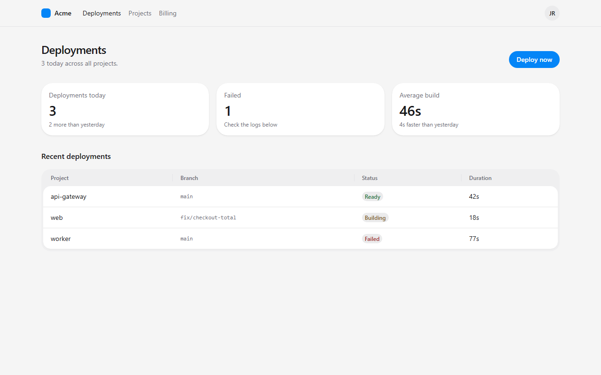
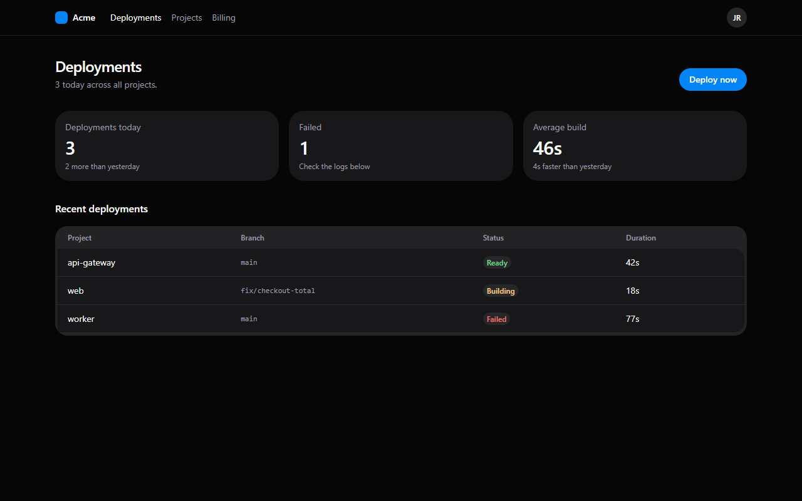

# claude-workbench

This is my whole [Claude Code](https://claude.com/claude-code) setup in one repo. It has three parts:

- **Skills** make Claude write plain English, keep git history readable, write strict TypeScript, and build web UI that looks designed rather than generated.
- **Mods** change how Claude Code itself runs. They pick the model for each agent, show a live session monitor beside the chat, and suggest `/clear` when a prompt starts a new task.
- **A shipping process** carries a code change from request to merged PR. GitHub issues track the work, each issue lists the checks that prove it's done, and I approve the plan and the PR.

A skill is a folder with a `SKILL.md` file. Claude loads a skill when a task matches its description, or when you type `/skill-name`. A mod is a plugin of function hooks. Keeping both in one repo gives every machine I use the same behavior, and anyone can borrow the parts they like.

## How a change ships

`ship-a-change` runs the process for any change worth a plan and a review. Small, clear changes skip the plan and the review, and Claude says so in one line. They still go through a PR I approve, and a reported failure still gets an issue first.

1. Understand the task. The vaguer the request, the more questions Claude asks before planning. When I report a failure, Claude first opens an issue, tries to reproduce it, and records the result on the issue. A large or vague task is split into checkpoints. Claude offers three styles, such as versions, vertical slices or phases, and versions continue from the project's current version. Each checkpoint is a GitHub milestone, and a project board shows them all.
2. Write one GitHub issue per piece of work, each with a "Done when" list of checks. The plan names the checks for every issue, and I approve it.
3. Agents build the change on a branch. Opus supervises, Sonnet writes code, Haiku does lookups.
4. Run the project's checks and every issue's "Done when" checks.
5. Review the full diff once, just before the PR to main.
6. Fix the findings and run the checks again.
7. Record mistakes worth remembering in the repo's `LESSONS.md`. This is the only step that writes lessons.
8. Open the PR, which closes its issues. I approve the merge.
9. Delete the branch. When a checkpoint is complete, close its milestone, and tag the version if the checkpoints are versions.

## What's inside

### Writing

| Skill | What it does |
|---|---|
| `unslop` | Removes AI writing patterns: filler, hedging, "leverage" and "delve", em dashes, sycophancy, and vague claims. `CLAUDE.md` imports it, so it applies to every reply. |
| `technical-writing` | Rules for docs, READMEs, and PRs, drawing on Diátaxis, the Google developer style guide, Simplified Technical English, and Global English. |
| `git-messages` | Commit messages and PR descriptions as short bullets that say what changed and why. They never include AI attribution lines. |

### Pull requests

| Skill | What it does |
|---|---|
| `ship-a-change` | Carries one code change from request to merged PR in nine steps, described above. You approve the plan and the final PR. |
| `verify-before-pr` | Runs the real checks and each issue's "Done when" checks, uses the change the way a user would, and writes the PR description with its risk tier. |
| `pr-review` | Reviews a diff for real bugs, once per PR. Finder agents each take one lens, and separate agents verify each finding. |
| `address-review-findings` | Gives every review finding an outcome, fixes each mistake everywhere it appears, and runs the checks again. |

### Code

| Skill | What it does |
|---|---|
| `typescript-best-practices` | Discriminated unions, branded types, no `as` casts, exhaustive switches, and schema-first validation. `references/patterns.md` has examples. |
| `principle-type-system-discipline` | Make illegal states unrepresentable, and let the compiler catch the rest. |
| `principle-boundary-discipline` | Validate data where it enters the system, and trust the types inside. |
| `principle-encode-lessons-in-structure` | When a correction repeats, turn it into a lint, check, or script instead of another instruction. |

### Models

| Skill | What it does |
|---|---|
| `model-roles` | Opus is the orchestrator: it plans, delegates, and supervises. Sonnet writes and reviews code. Haiku does lookups and mechanical edits. The `model-policy` mod enforces it. |

### Mods

A mod is a plugin of function hooks that changes how Claude Code itself behaves: which tool calls run, what the status line shows, which slash commands exist. Mods live in `mods/`, and `.claude-plugin/marketplace.json` lists them, so this repo is also a plugin marketplace.

| Mod | What it does |
|---|---|
| `model-policy` | Keeps Opus for the main session only. Every subagent runs on Sonnet at most, Workflow agents included, and forks are denied. Blocks the main session from writing code and Markdown or text files (`.md`, `.mdx`, `.markdown`, `.txt`) through Edit and Write, except in the auto-memory directory `~/.claude/projects/*/memory/`. It also checks shell commands for those writes, as a best-effort guard with known gaps such as `bash -c` strings. Subagents are not blocked. Lookups and `Explore` stay on Haiku. Ships four agents: `scout` (Haiku, read-only), `mechanic` (Haiku, mechanical edits), `coder` (Sonnet), and `reviewer` (Sonnet, no edit tools). When a new session starts, it asks which model to use (Opus, Sonnet or Haiku) and switches to the pick. When the main session runs on Haiku, every agent runs on Haiku. The `askModelAtStart` setting in `/config` turns the question off. Past 95% of your 5-hour limit, it asks before a Workflow starts. `/model-policy week` shows seven days of tokens by model and agent type. `/model-policy off` turns it off for a session. |
| `session-monitor` | A sidebar pane with every subagent this session started (task, status, model, elapsed time, tool calls, tokens), the 5-hour and 7-day subscription limits with reset times, context fill, and session cost. Bars turn amber at 70% and red at 90%. `/monitor` opens it. The pane header shows the folder, git branch (with `*` for uncommitted changes), and main model, and a Policy section shows the `model-policy` tally when that mod is installed. Each limit shows when it fills at the current pace. Each agent and the main session show what they edited, and pressing a row expands it to files, read folders, and recent tools. It sets no status line. |
| `session-coach` | When context is past 20% and your new prompt looks like a different task, it suggests `/clear` above the prompt. Haiku makes that call alongside your prompt, without delaying it. It also caps each Workflow run at 12 agents, halved past 80% of the 5-hour limit, and warns when the session passes 25, 50, and 100 agents. Change the limits in `/config`. |

### Web UI

| Skill | What it does |
|---|---|
| `web-ui` | One design language for every web project, built on [HeroUI v3](https://heroui.com) and Tailwind CSS v4. It covers React, Next.js, Vue, Svelte, Astro, and plain HTML. It includes design tokens, page recipes, a list of AI-slop patterns to avoid, and the same dashboard built in React, Vue, and HTML. |
| `heroui-react` | HeroUI's official skill for component APIs and docs. It's included unchanged. |

Here is the `web-ui` example dashboard. The React, Vue, and HTML versions all render this way. Dark mode comes from the theme tokens, with no changes to component code.





## Install

Clone the repo anywhere, then run the install script:

```bash
git clone https://github.com/asarelcastellanos/claude-workbench.git ~/claude-workbench
```

| OS | Command |
|---|---|
| Windows (PowerShell) | `~/claude-workbench/install.ps1` |
| macOS or Linux | `bash ~/claude-workbench/install.sh` |

The script links each folder in `skills/` into `~/.claude/skills/`. On Windows it uses directory junctions, which need no admin rights. It also adds one import line to `~/.claude/CLAUDE.md` that points at this repo's `CLAUDE.md`. If you already have a skill with the same name, the script moves it to `~/.claude/skills-backup-<timestamp>/` first. If the `claude` CLI is installed, the script also adds every folder in `mods/` to `CLAUDE_CODE_PLUGIN_DIRS` in the `env` block of `~/.claude/settings.json`, and removes any copy of the mods installed from a marketplace. Claude Code then loads the mods straight from this folder. A saved edit reloads in a running session, and after a `git pull` you run `/reload-plugins`. Like the skills, the mods follow the branch you have checked out. The settings change applies to sessions started after the script runs. Running the script again is safe. On macOS and Linux the script needs `python3` to edit `settings.json`.

The skills are links, not copies, so `git pull` updates them. You don't need to reinstall.

### The mods run code from your checkout

The mods are hooks, and Claude Code runs them with your permissions. Because they load from this folder, every session runs the mod code on the branch you have checked out. Keep this clone on `main`, and review other people's branches and PRs in a separate clone or a git worktree. Otherwise, checking out an untrusted branch runs its hooks in your next session.

### Install only some mods

To keep only some mods, remove the others' folders from `CLAUDE_CODE_PLUGIN_DIRS` in `~/.claude/settings.json`. Running the install script adds them back.

Without cloning the repo, you can install one mod from GitHub instead:

```
/plugin install session-monitor --marketplace asarelcastellanos/claude-workbench
```

Don't do both on one machine, or the mod loads twice.

### Install only some skills

Copy the folders you want into `~/.claude/skills/` (every project) or `.claude/skills/` (one project). The skills are plain Markdown. Only `heroui-react` has scripts, and those need Node.js 18 or later.

Most skills stand alone. These depend on others:

- `technical-writing` and `git-messages` apply `unslop`, and `technical-writing` hands commit messages and PR descriptions to `git-messages`.
- `typescript-best-practices` and `principle-boundary-discipline` refer to `principle-type-system-discipline`, and it refers to `principle-encode-lessons-in-structure`.
- `web-ui` applies `typescript-best-practices` and `principle-boundary-discipline` to the code it writes.
- `web-ui` works best with `heroui-react` for React projects.
- `model-roles` needs the `model-policy` mod. The three mods work alone or together. `pr-review` uses its `model-policy:reviewer` agent.
- `ship-a-change` runs `verify-before-pr`, `pr-review` and `address-review-findings`. `verify-before-pr` writes the PR description with `git-messages`.

## Make it yours

- **Writing rules:** edit `CLAUDE.md` to change what applies to every conversation.
- **Brand color:** change `--accent` in your project's CSS. Every `web-ui` component follows it. See `skills/web-ui/references/setup.md`.
- **Model policy:** type `/model-policy off` to turn it off for one session. Edit `mods/model-policy/hooks/policy.ts` to change which models it picks or which files the main session may write, then run `/reload-plugins`.
- **New mods:** add a folder under `mods/`, list it in `.claude-plugin/marketplace.json`, and run the install script again.
- **New skills:** add a folder with a `SKILL.md` under `skills/`, then run the install script again.

## License

[MIT](LICENSE), except `skills/heroui-react/`. That folder is copied unchanged from [heroui-inc/heroui](https://github.com/heroui-inc/heroui/tree/v3/skills/heroui-react) under the Apache License 2.0, and its license is in `skills/heroui-react/LICENSE.txt`. The token values and principles in `skills/web-ui/references/` summarize HeroUI's public documentation.
